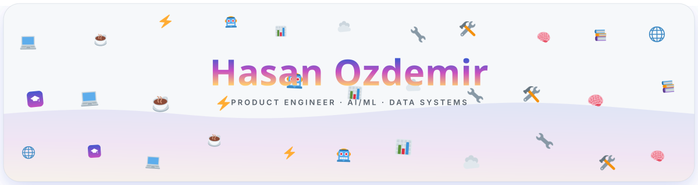

<picture>
  <source media="(prefers-color-scheme: dark)" srcset="assets/generated/banner-header-dark.svg">
  
</picture>

 

&nbsp;
&nbsp;

 

<samp>
<b>Software evangelizer</b> with a passion for AI/ML, Automation, Knowledge Management, Data Processing — committed to building apps and tools that make a meaningful change.
</samp>

 

<picture>
  <source media="(prefers-color-scheme: dark)" srcset="https://streak-stats.demolab.com/?user=yoshibase&theme=radical&hide_border=true&card_width=300&card_height=120">
  
</picture>

 

<picture>
  <source media="(prefers-color-scheme: dark)" srcset="assets/generated/tech-stack-dark.svg">
  
</picture>

 

<!--TRENDING_START-->

<h3>🔥 Trending Today</h3>

<table style="border-collapse:collapse;font-family:Inter,sans-serif;width:100%;max-width:900px;margin:0 auto">
<tr style="background:linear-gradient(135deg,#4158D0,#C850C0);color:#fff;font-size:10px">
<th style="padding:6px 10px">#</th>
<th style="padding:6px 10px"></th>
<th style="padding:6px 10px;text-align:left">Repo</th>
<th style="padding:6px 10px;text-align:left">Description</th>
<th style="padding:6px 10px;text-align:right">Stats</th>
</tr>
<tr><td style="text-align:center;font-size:11px;font-weight:600;color:#C850C0">#1</td><td style="font-size:12px">🇮🇳 📦</td><td style="font-size:11px"><a href="https://github.com/Gathin23/cleanyourtv"><b>Gathin23/cleanyourtv</b></a></td><td style="font-size:10px;color:#8B949E">Debloat any Android or Google TV over Wi-Fi and get an Apple TV-style home.</td><td style="text-align:right;font-size:10px;color:#C850C0">⭐35.6k 🍴4.2k +3.6k today</td></tr><tr><td style="text-align:center;font-size:11px;font-weight:600;color:#C850C0">#2</td><td style="font-size:12px">🌍 🧬</td><td style="font-size:11px"><a href="https://github.com/Ebony-Vinyl/dsh-our-free-model"><b>Ebony-Vinyl/dsh-our-free-model</b></a></td><td style="font-size:10px;color:#8B949E">在 dsh 里装上这个插件即可，无需登录、注册或填 API Key，就能使用包括 DeepSeek V4.1 Flash、Kimi K3 在内的前沿模型——完全免费，不限量。 All you do is install this plugin in dsh: no login, no sign-up, no API key — the frontier models are just there, DeepSeek V4.1 Flash and Kimi K3 among them. Completely free, with no usage cap.</td><td style="text-align:right;font-size:10px;color:#C850C0">⭐43.1k 🍴1.2k +1.7k today</td></tr><tr><td style="text-align:center;font-size:11px;font-weight:600;color:#C850C0">#3</td><td style="font-size:12px">🌍 🤖</td><td style="font-size:11px"><a href="https://github.com/lemomo-ai/lemo-opuscar"><b>lemomo-ai/lemo-opuscar</b></a></td><td style="font-size:10px;color:#8B949E">A toolbox of film styles made in code for Claude Code: 59 ready to use, and your own. Each style is a style prompt plus a demo film made entirely in code by Claude Opus 5.5, with no video model. By Lemomo. · 一套用代码做片的风格工具箱：59 种现成风格，也能做出你自己的</td><td style="text-align:right;font-size:10px;color:#C850C0">⭐7.5k 🍴842 +794 today</td></tr>
</table>

<!--TRENDING_END-->

 

<!--REPO_OF_DAY_START-->

<h3>📦 Repo of the Day — Last 30 Days</h3>

<table style="border-collapse:separate;border-spacing:6px;font-family:Inter,sans-serif;width:100%;max-width:1000px;margin:0 auto">
<tr><td style="padding:8px;border:1px solid #30363D;border-radius:8px;vertical-align:top;width:33%">
Oct 26

🌍 📦 <a href="https://github.com/simbasjungles/free-my-tv"><b>simbasjungles/free-my-tv</b></a>

A fast, ad-free home screen for Google TV, LG webOS and Samsung Tizen. One button to undo.

⭐4.6k
</td><td style="padding:8px;border:1px solid #30363D;border-radius:8px;vertical-align:top;width:33%">
Oct 25

🌍 📱 <a href="https://github.com/Jakeschincariol/replica-skill"><b>Jakeschincariol/replica-skill</b></a>

Eleven free Claude skills that clone any app: reverse-engineer it, rebuild it, test it for bugs, then fix what its users hate. Free, MIT.

⭐5.3k
</td><td style="padding:8px;border:1px solid #30363D;border-radius:8px;vertical-align:top;width:33%">
Oct 24

🌍 🔧 <a href="https://github.com/yihui-dev/awesome-opus5-5-videos"><b>yihui-dev/awesome-opus5-5-videos</b></a>

A growing collection of viral videos made with Claude Opus 5.5 and the prompts behind them. Watch each original next to a live remake on Skillry. Updated regularly.

⭐9.9k
</td></tr><tr><td style="padding:8px;border:1px solid #30363D;border-radius:8px;vertical-align:top;width:33%">
Oct 23

🌍 🤖 <a href="https://github.com/deepseek-ai/DeepInfer"><b>deepseek-ai/DeepInfer</b></a>

DeepInfer: High-performance, large-scale inference framework for DeepSeek models

⭐20.1k
</td><td style="padding:8px;border:1px solid #30363D;border-radius:8px;vertical-align:top;width:33%">
Oct 22

🌍 🤖 <a href="https://github.com/lemomo-ai/lemo-opuscar"><b>lemomo-ai/lemo-opuscar</b></a>

Claude Code skill for short films with no video model: 51 film styles, each a style prompt plus a demo film made entirely in code by Claude Opus 5.5 (incl. OPUSCAR 98 and the new Evidence Films). By Lemomo. · Opus5.5 x 51 种影片风格：风格提示词 + 纯代码样片 + 导演与技术指南（新增「实证影像」）

⭐5.0k
</td><td style="padding:8px;border:1px solid #30363D;border-radius:8px;vertical-align:top;width:33%">
Oct 21

🌍 📦 <a href="https://github.com/google-research/harness2"><b>google-research/harness2</b></a>

⭐15.7k
</td></tr><tr><td style="padding:8px;border:1px solid #30363D;border-radius:8px;vertical-align:top;width:33%">
Oct 20

🇰🇷 🎵 <a href="https://github.com/KnifeLemon/Filee"><b>KnifeLemon/Filee</b></a>

Free, open-source file converter. Convert 244+ formats offline by drag & drop — images, PDF, Word, Excel, PowerPoint, HWP/HWPX, video, audio, e-books and archives. No upload, no Office needed.

⭐6.7k
</td><td style="padding:8px;border:1px solid #30363D;border-radius:8px;vertical-align:top;width:33%">
Oct 19

🌍 🧬 <a href="https://github.com/Ebony-Vinyl/dsh-our-free-model"><b>Ebony-Vinyl/dsh-our-free-model</b></a>

在 dsh 里装上这个插件即可，无需登录、注册或填 API Key，就能使用包括 DeepSeek V4.1 Flash、Kimi K3 在内的前沿模型——完全免费，不限量。 All you do is install this plugin in dsh: no login, no sign-up, no API key — the frontier models are just there, DeepSeek V4.1 Flash and Kimi K3 among them. Completely free, with no usage cap.

⭐25.1k
</td><td style="padding:8px;border:1px solid #30363D;border-radius:8px;vertical-align:top;width:33%">
Oct 18

🌍 🧠 <a href="https://github.com/wheresryan22/anatomy"><b>wheresryan22/anatomy</b></a>

An agent skill for creating detailed, interactive isometric illustrations of real-world machines and complex systems. Generates polished SVGs with optional WebGL shaders and 3D effects.

⭐15.2k
</td></tr><tr><td style="padding:8px;border:1px solid #30363D;border-radius:8px;vertical-align:top;width:33%">
Oct 17

🇺🇸 🤖 <a href="https://github.com/Edge0-AI/Edge0"><b>Edge0-AI/Edge0</b></a>

Run 35B MoE models in ~2.5 GB of RAM. Weights stream from SSD; a trained router predicts loads a step ahead. Mac, iPhone, Android, Windows supported

⭐5.4k
</td><td style="padding:8px;border:1px solid #30363D;border-radius:8px;vertical-align:top;width:33%">
Oct 16

🌍 🦀 <a href="https://github.com/storytold/cadcraft"><b>storytold/cadcraft</b></a>

CADCraft: computer-aided design and drafting — an open-source, clean-room AutoCAD-style app in pure Rust

⭐5.2k
</td><td style="padding:8px;border:1px solid #30363D;border-radius:8px;vertical-align:top;width:33%">
Oct 15

🌍 🦀 <a href="https://github.com/storytold/effectcraft"><b>storytold/effectcraft</b></a>

EffectCraft: An open-source motion graphics and compositing tool written by scratch in pure Rust

⭐6.6k
</td></tr><tr><td style="padding:8px;border:1px solid #30363D;border-radius:8px;vertical-align:top;width:33%">
Oct 14

🌍 🦀 <a href="https://github.com/storytold/pdfcraft"><b>storytold/pdfcraft</b></a>

PdfCraft: An open-source PDF reader and editor written by scratch in pure Rust

⭐12.9k
</td><td style="padding:8px;border:1px solid #30363D;border-radius:8px;vertical-align:top;width:33%">
Oct 13

🌍 🦀 <a href="https://github.com/storytold/vectorcraft"><b>storytold/vectorcraft</b></a>

VectorCraft: An open-source, vector art tool written by scratch in pure Rust

⭐8.0k
</td><td style="padding:8px;border:1px solid #30363D;border-radius:8px;vertical-align:top;width:33%">
Oct 12

🌍 🦀 <a href="https://github.com/storytold/wordcraft"><b>storytold/wordcraft</b></a>

An open-source, clean-room reimplementation of Microsoft Word in pure Rust

⭐6.4k
</td></tr><tr><td style="padding:8px;border:1px solid #30363D;border-radius:8px;vertical-align:top;width:33%">
Oct 11

🌍 🦀 <a href="https://github.com/storytold/lightcraft"><b>storytold/lightcraft</b></a>

An open-source, clean-room reimplementation of Adobe Lightroom in pure Rust.

⭐9.1k
</td><td style="padding:8px;border:1px solid #30363D;border-radius:8px;vertical-align:top;width:33%">
Oct 10

🌍 🦀 <a href="https://github.com/storytold/photocraft"><b>storytold/photocraft</b></a>

An open-source, clean-room reimplementation of Adobe Photoshop in pure Rust

⭐36.3k
</td><td style="padding:8px;border:1px solid #30363D;border-radius:8px;vertical-align:top;width:33%">
Oct 9

🌍 🦀 <a href="https://github.com/storytold/filmcraft"><b>storytold/filmcraft</b></a>

An open-source, clean-room reimplementation of Adobe Premiere Pro built in pure Rust.

⭐5.6k
</td></tr><tr><td style="padding:8px;border:1px solid #30363D;border-radius:8px;vertical-align:top;width:33%">
Oct 8

🌍 📦 <a href="https://github.com/Droid-Deck/DroidDeck"><b>Droid-Deck/DroidDeck</b></a>

DroidDeck brings the SteamOS experience to Android

⭐3.3k
</td><td style="padding:8px;border:1px solid #30363D;border-radius:8px;vertical-align:top;width:33%">
Oct 7

🌍 🔌 <a href="https://github.com/Niko1221/Strata"><b>Niko1221/Strata</b></a>

Qwen3.8-Flash-Next on any consumer hardware: one-click install for Windows / Linux. Strata inference engine, OpenAI/Anthropic API on localhost, optional image input.

⭐16.0k
</td><td style="padding:8px;border:1px solid #30363D;border-radius:8px;vertical-align:top;width:33%">
Oct 6

🌍 ⚡ <a href="https://github.com/rehan-remade/universal-modder"><b>rehan-remade/universal-modder</b></a>

Point Claude at any game. Skills, tools and the fal MCP that let Claude Code mod almost any PC game you own: recon, reverse engineering, fal-generated art/3D/audio, in-game testing, showcase videos.

⭐3.9k
</td></tr><tr><td style="padding:8px;border:1px solid #30363D;border-radius:8px;vertical-align:top;width:33%">
Oct 5

🌍 📦 <a href="https://github.com/cdyforever/how-to-live-better"><b>cdyforever/how-to-live-better</b></a>

《高性价比人生指南》全书 528 条的在线单页阅读版：手机可读、可搜索、零依赖、支持离线

⭐7.4k
</td><td style="padding:8px;border:1px solid #30363D;border-radius:8px;vertical-align:top;width:33%">
Oct 4

🌍 📦 <a href="https://github.com/shihabal3amri/DiPlay"><b>shihabal3amri/DiPlay</b></a>

Independent CarPlay receiver for compatible Android head units. Wired and wireless public preview.

⭐3.1k
</td><td style="padding:8px;border:1px solid #30363D;border-radius:8px;vertical-align:top;width:33%">
Oct 3

🌍 📦 <a href="https://github.com/Mak5er/AirCard"><b>Mak5er/AirCard</b></a>

Apple Wallet Card Skinner for iOS 18+ (No Jailbreak Required)

⭐5.8k
</td></tr><tr><td style="padding:8px;border:1px solid #30363D;border-radius:8px;vertical-align:top;width:33%">
Oct 2

🇨🇳 🧠 <a href="https://github.com/yetone/magpie"><b>yetone/magpie</b></a>

Every agent's model. One place. Codex on DeepSeek, Claude Code on Kimi, from the menu bar.

⭐4.1k
</td><td style="padding:8px;border:1px solid #30363D;border-radius:8px;vertical-align:top;width:33%">
Oct 1

🌍 🧠 <a href="https://github.com/CopilotKit/openmuse"><b>CopilotKit/openmuse</b></a>

A personal agent with a browser, terminal, files, and work that keeps going built with CopilotKit and AG-UI.

⭐3.5k
</td><td style="padding:8px;border:1px solid #30363D;border-radius:8px;vertical-align:top;width:33%">
Sep 30

🌍 📱 <a href="https://github.com/SonicloudTech/sonicloud_opensdk"><b>SonicloudTech/sonicloud_opensdk</b></a>

声云录音卡 Recorder 是一套面向开发者和行业客户的智能录音硬件接入方案。 项目以录音卡片硬件为核心，开放 BLE 协议 SDK 及 Android、iOS、鸿蒙、Flutter 接入示例，同时提供 Windows/macOS 桌面端 Demo，支持设备连接、录音控制、实时音频、文件传输、OTA 升级和语音转写等能力，帮助开发者快速将录音硬件接入自己的 App、桌面软件或行业系统。 如需获取硬件规格、样机、完整协议、SDK 资料或定制服务，请联系安徽声云

⭐2.9k
</td></tr><tr><td style="padding:8px;border:1px solid #30363D;border-radius:8px;vertical-align:top;width:33%">
Sep 29

🌍 🤖 <a href="https://github.com/Ryze-AI-Adgent/open-seo-mcp-skills"><b>Ryze-AI-Adgent/open-seo-mcp-skills</b></a>

Free SEO MCP server + open-source SEO and GEO skills for Claude: keyword research, rank tracking, audits, backlinks, AI visibility on your real GSC/GA4/ads data. claude mcp add ryze --transport http https://connector.get-ryze.ai/mcp

⭐2.7k
</td><td style="padding:8px;border:1px solid #30363D;border-radius:8px;vertical-align:top;width:33%">
Sep 28

🇫🇮 🤖 <a href="https://github.com/amosblomqvist/learn"><b>amosblomqvist/learn</b></a>

My AI learning system.

⭐2.6k
</td><td style="padding:8px;border:1px solid #30363D;border-radius:8px;vertical-align:top;width:33%">
Sep 27

🌍 📦 <a href="https://github.com/jaredpalmer/kev"><b>jaredpalmer/kev</b></a>

Jev-like family of decision models built on top of Qwen3.5/3.8 you can train and run on your own

⭐7.2k
</td></tr>
</table>

Last synced Oct 26, 2026 · automated daily

<!--REPO_OF_DAY_END-->

 

<picture>
  <source media="(prefers-color-scheme: dark)" srcset="assets/generated/banner-footer-dark.svg">
  
</picture>

<!--SYNCED_AT_START-->
<!-- synced: 2026-10-26 02:56 UTC -->
<!--SYNCED_AT_END-->
